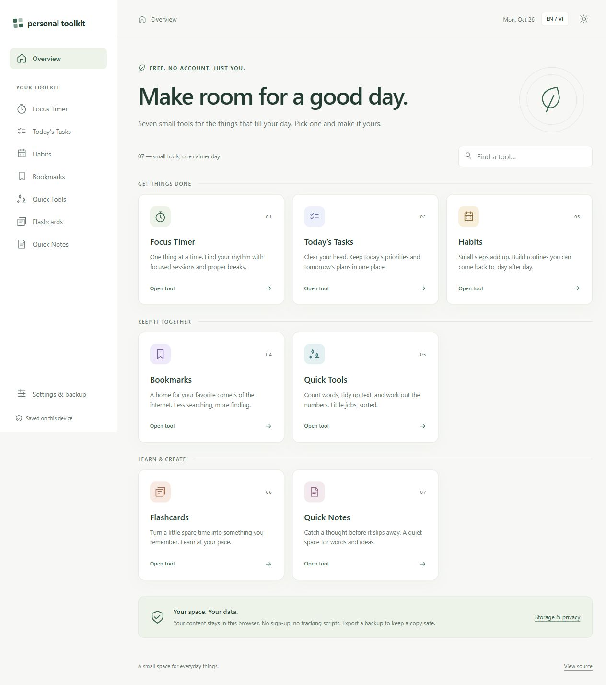

# Personal Toolkit

Một góc nhỏ để tập trung, sắp xếp công việc và học tập mỗi ngày.

[English](README.md) · [Yêu cầu dự án](docs/requirements.md) · [Lộ trình](docs/roadmap.md)

**Trạng thái: bản thử nghiệm chạy trên máy, chưa xuất bản công khai.** Cả 7 công
cụ đã được xây dựng; vẫn cần kiểm tra thêm trên các trình duyệt và thiết bị.



## Có gì trong bộ công cụ?

- **Đồng hồ tập trung:** phiên làm việc, nghỉ ngắn/dài, lịch sử và chọn việc đang làm.
- **Việc hôm nay:** tạo, sửa, đánh dấu hoàn thành; phân loại theo ngày.
- **Thói quen:** đánh dấu hằng ngày, xem tuần gần nhất và chuỗi ngày duy trì.
- **Đường dẫn:** lưu link, chia nhóm và tìm kiếm.
- **Công cụ nhanh:** đếm từ/ký tự, đổi hoa–thường, làm gọn khoảng trắng và tính toán cơ bản.
- **Thẻ học:** tạo bộ thẻ, ôn tập và lưu tiến độ.
- **Ghi chú nhanh:** văn bản thuần, tự lưu và tìm kiếm.

Giao diện mặc định bằng tiếng Anh, có nút chuyển sang tiếng Việt và giao diện
sáng/tối. Mỗi công cụ có trang riêng, không cần tài khoản.

## Chạy trên máy

Cần Node.js từ phiên bản 22 trở lên. Không cần cài thư viện hay cung cấp khóa API.
Nếu đã có repo trên máy, mở PowerShell tại thư mục dự án và chạy:

```powershell
node scripts/serve.mjs
```

Mở [http://127.0.0.1:4173](http://127.0.0.1:4173), giữ cửa sổ PowerShell mở trong
khi dùng. Nhấn Ctrl+C để dừng. Không mở trực tiếp file HTML bằng `file://`.

## Dữ liệu và sao lưu

Dữ liệu chính lưu trong IndexedDB của trình duyệt. Giao diện và ngôn ngữ lưu
trong localStorage. Không tự đồng bộ giữa thiết bị, hồ sơ hoặc trình duyệt.

Trong **Cài đặt & sao lưu**, bạn có thể xuất tất cả dữ liệu hoặc từng công cụ
thành JSON. Khi nhập lại, ứng dụng kiểm tra file, hiển thị phạm vi thay thế và
chờ xác nhận. Giới hạn nhập là 10 MiB mỗi file. Nên sao lưu trước khi khôi phục.

- Xóa dữ liệu trang, dùng ẩn danh hoặc trình duyệt dọn bộ nhớ có thể làm mất dữ liệu.
- File sao lưu chưa mã hóa; không dùng ứng dụng để giữ mật khẩu hoặc bí mật.
- Văn bản và phép tính trong Công cụ nhanh là dữ liệu tạm, không tự lưu.
- Ứng dụng không chủ động tải nội dung cá nhân lên máy chủ. Hosting vẫn nhận
  yêu cầu tải trang; mở bookmark sẽ kết nối tới website đích.

## Kiểm tra và tạo bản xuất bản

```powershell
node --test tests/*.test.mjs
node scripts/check.mjs
node scripts/build.mjs
```

Lệnh build tạo lại `dist/`. Workflow GitHub Pages đã có sẵn; sau khi đẩy mã lên
GitHub, chọn **Settings → Pages → GitHub Actions** và kiểm tra kết quả triển khai.
Hướng dẫn chi tiết nằm trong [README tiếng Anh](README.md#deploy-to-github-pages).

Đã kiểm tra trên Chromium trong Windows; chưa hoàn tất kiểm tra Firefox,
Safari, điện thoại thật và khả năng tiếp cận. Xem [kết quả kiểm tra](docs/verification.md).

## Đóng góp và giấy phép

Báo lỗi hoặc đề xuất cải tiến qua Issues. Chỉ dùng dữ liệu mẫu trong ảnh chụp
và báo lỗi; không gửi file sao lưu cá nhân. Đọc [hướng dẫn đóng góp](CONTRIBUTING.md)
và [chính sách bảo mật](SECURITY.md) trước khi gửi.

Mã nguồn được chia sẻ theo [giấy phép MIT](LICENSE).
